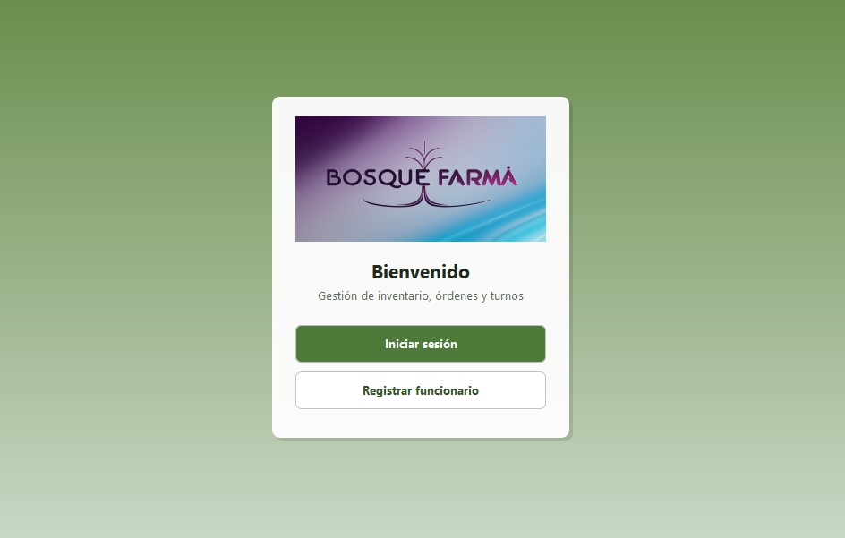
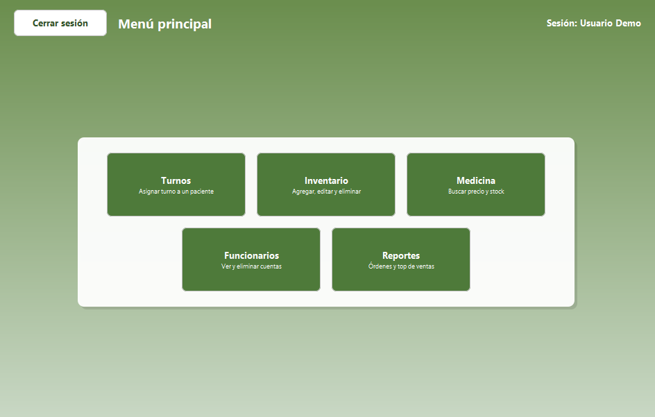
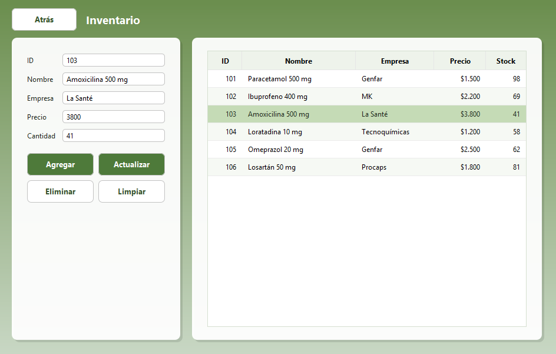
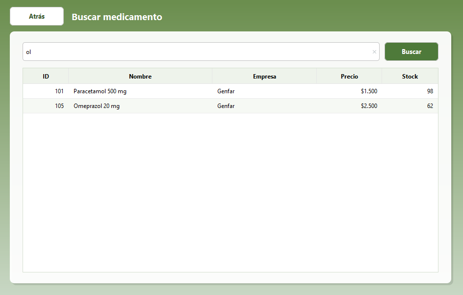
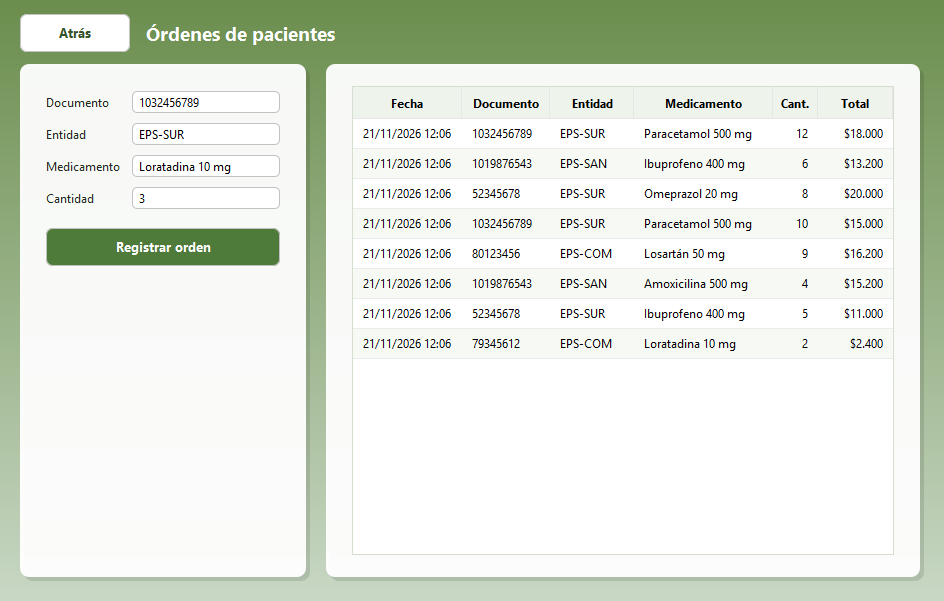
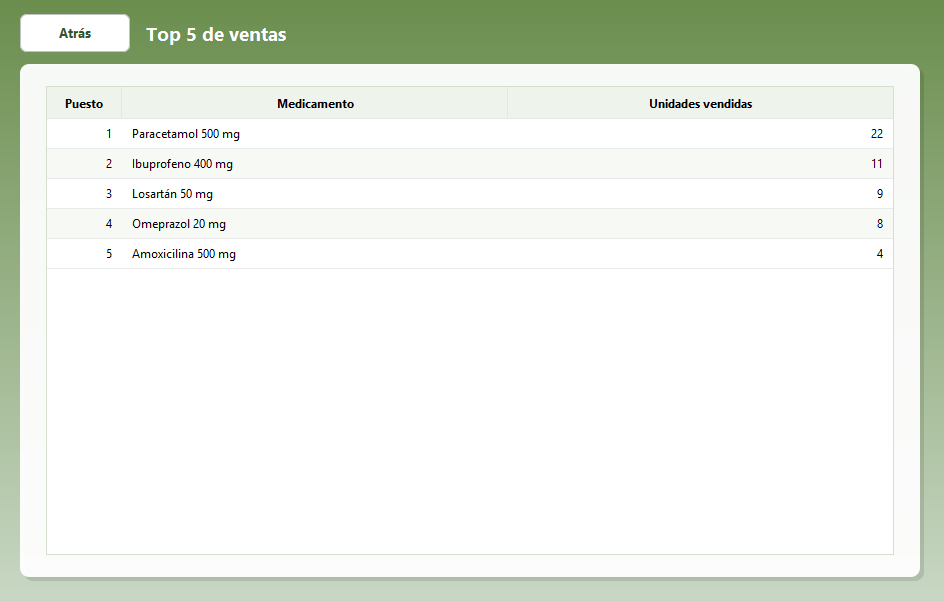
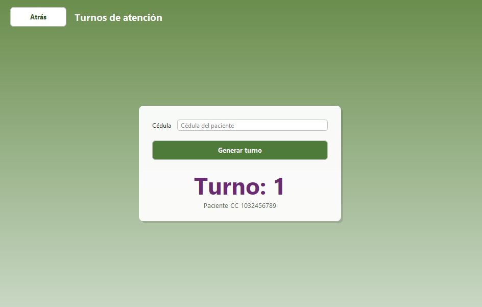
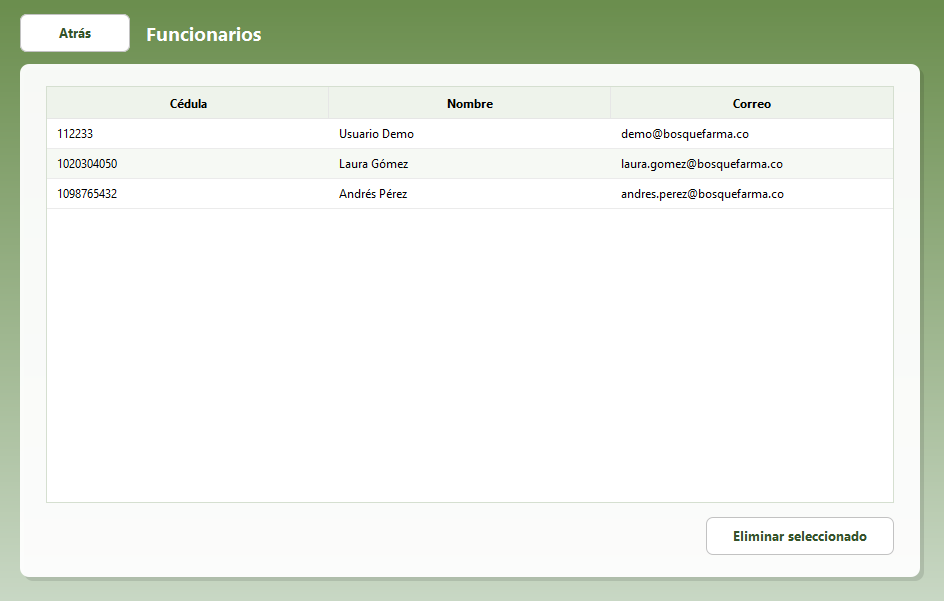
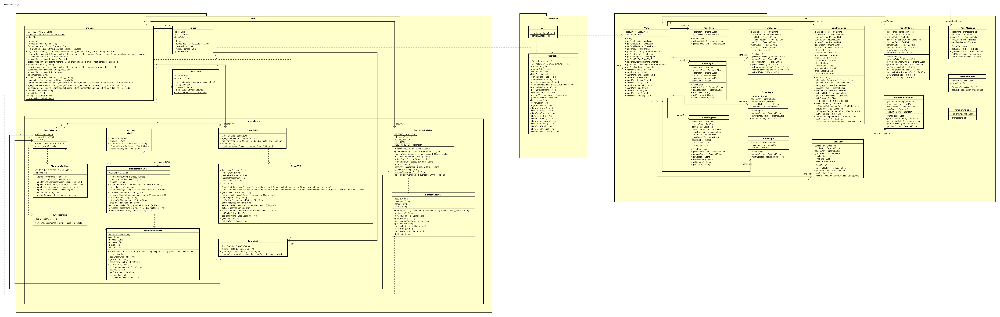

# BosqueFarma

[Español](README.md) | **English**

A **Java Swing** desktop application for running a pharmacy: staff accounts, medicine inventory, patient queue numbers, patient orders and sales reports.

It started as a university project and has been refactored in cycles (see [Roadmap](#roadmap)) into clean, tested and documented code. The user interface is in Spanish.

[](https://github.com/Kesagaro/ProyectoMeditech/actions/workflows/ci.yml)    

## Download and try it

1. Install **Java 17 or later** (for example [Temurin](https://adoptium.net/)).
2. Download [**BosqueFarma.jar**](https://github.com/Kesagaro/ProyectoMeditech/releases/latest/download/BosqueFarma.jar) from the [latest release](https://github.com/Kesagaro/ProyectoMeditech/releases/latest).
3. Open it with a double click or with `java -jar BosqueFarma.jar`.

On first launch, create a user with **Registrar funcionario** (Sign up). Data is stored in a `data/` folder next to the `.jar`.

## Features

- Staff sign-up (ID number, name, email) and login; the main menu shows who is signed in
- Inventory in a sortable table: add, update and delete medicines; selecting a row loads it into the form for editing
- Medicine search by name, with price and stock
- Patient queue numbers tied to the patient's ID; the count survives restarts and resets to 1 every day
- Patient orders that check the medicine and the available stock, deduct it from the inventory and record the date and total in Colombian pesos
- Staff table (without passwords); remove the member selected in the table
- Reports: top 5 best-selling medicines, computed from the recorded orders

## Screenshots

| Start screen | Main menu |
|---|---|
|  |  |
| **Inventory** | **Medicine search** |
|  |  |
| **Patient orders** | **Top sellers** |
|  |  |
| **Queue numbers** | **Staff** |
|  |  |

Screenshots taken from the application with sample data.

## Tech stack

- Java 17+ (tested with JDK 17, 21 and 25)
- Swing with [FlatLaf](https://www.formdev.com/flatlaf/) (modern look and feel), sortable tables and a custom theme of colors and fonts (`Tema`)
- SQLite with JDBC (embedded database in a single file, no server to install)
- Maven (with Maven Wrapper) and JUnit 5
- GitHub Actions: builds and runs the tests on every push and pull request, and publishes the `.jar` on each release tag

## Run in VS Code

1. Install **JDK 17 or later** (for example [Temurin](https://adoptium.net/)).
2. Open the project folder in VS Code.
3. Install the recommended **Extension Pack for Java** (VS Code suggests it when the project opens).
4. Press **F5** and choose **Ejecutar BosqueFarma**.

Demo user: ID `112233`, password `112233`.

### From the terminal

Run from the project root (data is stored in `data/`, relative to that folder). Maven does not need to be installed: `mvnw` downloads it the first time (on Windows, use `mvnw.cmd`).

```bash
./mvnw compile exec:java
```

To build the executable `target/BosqueFarma.jar`:

```bash
./mvnw package
```

Pushing a tag that matches the `pom.xml` version (for example `v1.1.0`) makes GitHub Actions publish that `.jar` on Releases.

## Tests

The JUnit 5 tests live in `src/test/java`. They cover queue numbers, the business rules (input validation, orders, stock, top 5) and the persistence of staff (password hashing), medicines, orders (sale and stock deduction in one transaction) and the import of files from older versions. Each test uses a database in a temporary folder and never touches `data/`.

```bash
./mvnw test
```

In VS Code they also appear in the **Testing** view (flask icon). GitHub Actions runs them on Java 17 and 21 for every push and pull request.

## Architecture (MVC)

```
src/main/java/co/edu/unbosque/
├── controller/          Main (entry point) and Controller (view events → model)
├── model/               Farmacia (facade and business rules), Resultado and Turnos
│   └── persistence/     BaseDeDatos (SQLite), DAOs and DTOs for staff, medicines, orders and queue numbers; legacy file import
└── view/                View (JFrame + CardLayout), one panel per screen, Tema (FlatLaf, colors and fonts) and Tabla

src/main/resources/            Application logo
src/test/java/co/edu/unbosque/ JUnit tests for the model and persistence
```

### Class diagram



Editable Astah model: [`docs/diagramas/BosqueFarma.asta`](docs/diagramas/BosqueFarma.asta).

### Persistence

Data is stored in a **SQLite** database at `data/bosquefarma.db`. SQLite ships inside the `.jar` as a library: there is no server to install or configure. Every query uses `PreparedStatement`, and recording an order deducts the stock in the same transaction.

| Table | Columns | Contents |
|---|---|---|
| `funcionarios` | `cedula`, `password`, `nombre`, `correo` | Staff; passwords are stored as salted PBKDF2 hashes |
| `medicamentos` | `id`, `nombre`, `empresa`, `precio`, `cantidad` | Inventory (stock can never go negative) |
| `ordenes` | `id`, `documento`, `entidad`, `medicamento`, `cantidad`, `fecha`, `total` | Orders; those imported from older versions have no date or total |
| `turnos` | `dia`, `siguiente` | Today's next queue number |

**Upgrading from version 1.1.0 or earlier:** when the database is first created, the application imports the files those versions used (`usuarios.txt`, `Medicamentos.txt`, `ordenes.txt` and `turnos.txt`) and leaves them untouched as a backup. This is also how the demo user in `data/usuarios.txt` is loaded.

## Roadmap

- [x] **Cycle 1: Critical bugs.** Duplicate listeners, queue numbers starting at 1, update by real ID, input validation, unique ID numbers.
- [x] **Cycle 2: Unfinished features.** List and delete inventory, store name and email on sign-up, patient ID on queue numbers, "Medicina" button.
- [x] **Cycle 3: Business logic.** Orders check and deduct stock; top 5 computed from real data.
- [x] **Cycle 4: Cleanup.** Clear names, dead code removed, resources loaded with `getResource()`.
- [x] **Cycle 5: Security and data.** Salted password hashes; robust CSV handling.
- [x] **Cycle 6: Tests.** JUnit for DAOs, queue numbers and business rules.

### Phase 2

- [x] **Cycle 7: Maven and CI.** Standard Maven layout, Maven Wrapper and GitHub Actions.
- [x] **Cycle 8: Executable release.** `BosqueFarma.jar` published on GitHub Releases.
- [x] **Cycle 9: Rules in the model.** Controller validations moved into the model, with tests.
- [x] **Cycle 10: Functional improvements.** Orders with date and total, persistent queue numbers, signed-in staff member.
- [x] **Cycle 11: Presentation.** English README and repository metadata.
- [x] **Cycle 12: Database.** SQLite persistence with JDBC.

### Phase 3

- [x] **Cycle 13: Modern interface.** FlatLaf, sortable tables for inventory, orders, staff, search and top 5, and one shared design across every screen.

## Documentation

- [`docs/`](docs/README.md): UML diagrams (Astah) and design decisions (in Spanish).
