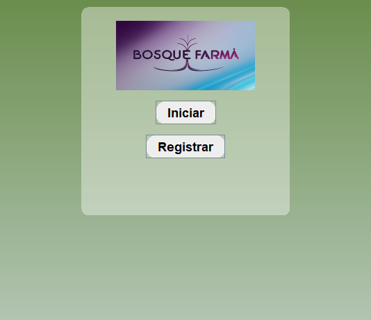
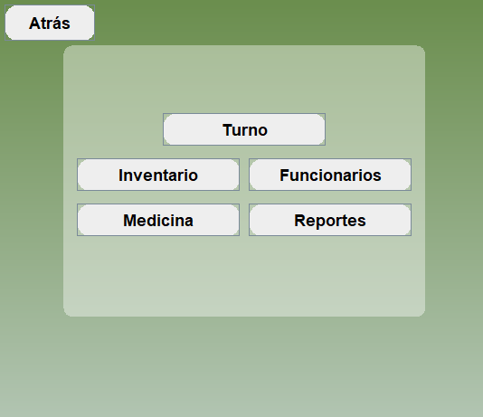
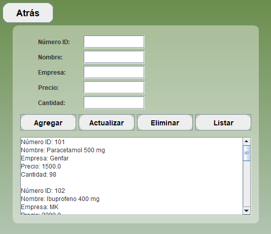
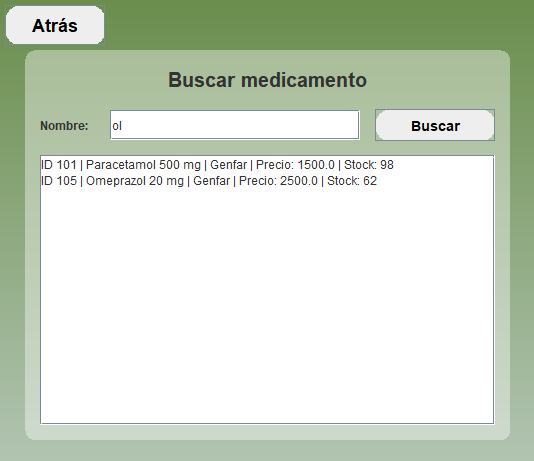
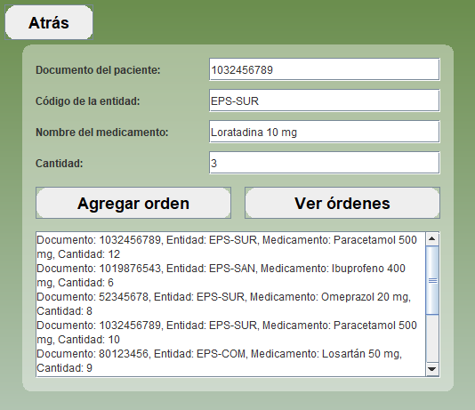
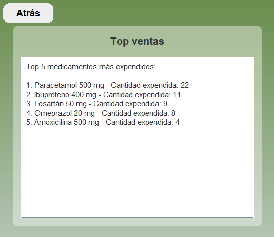
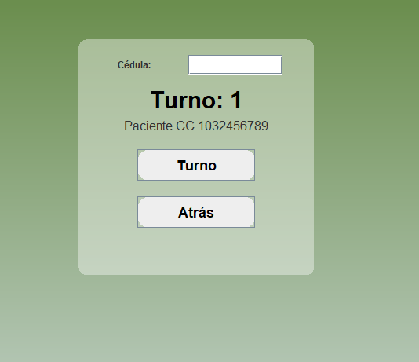
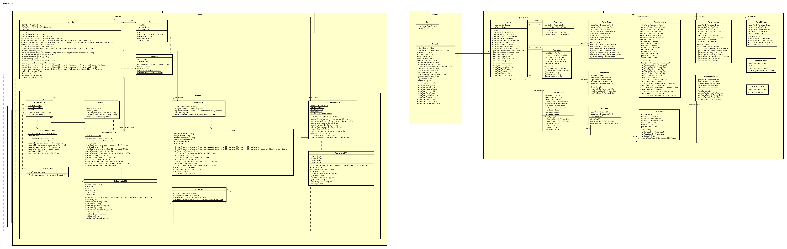

# BosqueFarma

Aplicación de escritorio en **Java Swing** para la gestión de una farmacia: funcionarios, inventario de medicamentos, turnos de atención, órdenes de pacientes y reportes.

Nació como proyecto académico y se está refactorizando por ciclos (ver [Roadmap](#roadmap)) para llevarlo a un código limpio, probado y documentado.

  

## Funcionalidades

- Registro (cédula, nombre, correo) e inicio de sesión de funcionarios
- Inventario: agregar, actualizar, listar y eliminar medicamentos por ID
- Búsqueda de medicamentos por nombre con precio y stock
- Generación de turnos de atención asociados a la cédula del paciente
- Órdenes de pacientes que validan el medicamento y el stock disponible, y lo descuentan del inventario
- Listado y eliminación de funcionarios
- Reportes: Top 5 de medicamentos más expendidos, calculado con las órdenes registradas

## Capturas

| Inicio | Menú principal |
|---|---|
|  |  |
| **Inventario** | **Búsqueda de medicamentos** |
|  |  |
| **Órdenes de pacientes** | **Top ventas** |
|  |  |
| **Turnos** | **Funcionarios** |
|  |  |

Capturas tomadas de la aplicación con datos de ejemplo.

## Tecnologías

- Java 22+ (probado con JDK 25)
- Swing (CardLayout, componentes personalizados)
- Persistencia en archivos: texto plano y serialización Java
- JUnit 5 para las pruebas automáticas

## Ejecutar en VS Code

1. Instalar un **JDK 22 o superior** (por ejemplo [Temurin](https://adoptium.net/)).
2. Abrir la carpeta del proyecto en VS Code.
3. Instalar la extensión recomendada **Extension Pack for Java** (VS Code la sugiere al abrir el proyecto).
4. Pulsar **F5** y elegir **Ejecutar BosqueFarma**.

Usuario de demostración: cédula `112233`, contraseña `112233`.

### Desde la terminal

Desde la raíz del proyecto (los datos se guardan en `data/`, relativo a esa carpeta):

```bash
javac -encoding UTF-8 -d bin $(find src -name "*.java")
```

```bash
cp src/BosqueFarma.png bin/
```

```bash
java -cp bin co.edu.unbosque.controller.Main
```

## Pruebas

Las pruebas JUnit 5 están en `test/` y cubren los turnos, las reglas de órdenes, stock y Top 5, y la persistencia de funcionarios (hash de contraseñas y migración), medicamentos y órdenes. Cada prueba trabaja en una carpeta temporal, sin tocar `data/`.

En VS Code aparecen en la vista **Testing** (ícono del matraz). Desde la terminal, después de compilar `src` como arriba:

```bash
javac -encoding UTF-8 -cp "bin:lib/*" -d bin-test $(find test -name "*.java")
```

```bash
java -jar lib/junit-platform-console-standalone-1.11.4.jar execute -cp "bin:bin-test" --scan-classpath
```

En Windows (Git Bash) se usa `;` en lugar de `:` para separar las rutas del classpath.

## Arquitectura (MVC)

```
src/co/edu/unbosque/
├── controller/          Main (punto de entrada) y Controller (eventos vista → modelo)
├── model/               Farmacia (fachada del modelo) y Turnos
│   └── persistence/     DAO y DTO de funcionarios, medicamentos y órdenes; interfaz Crud<T>
└── view/                View (JFrame + CardLayout) y un panel por pantalla

test/co/edu/unbosque/model/   Pruebas JUnit del modelo y la persistencia
```

### Diagrama de clases



Modelo editable en Astah: [`docs/diagramas/BosqueFarma.asta`](docs/diagramas/BosqueFarma.asta).

### Persistencia

| Archivo | Formato | Contenido |
|---|---|---|
| `data/usuarios.txt` | texto `cedula,hash,nombre,correo` | Funcionarios; la contraseña se guarda como hash PBKDF2 con sal |
| `data/Medicamentos.txt` | serialización Java | Inventario |
| `data/ordenes.txt` | texto `documento,entidad,medicamento,cantidad` | Órdenes |

## Roadmap

- [x] **Ciclo 1: Bugs críticos.** Listeners duplicados, turnos desde 1, actualizar por ID real, validación de entradas, cédulas únicas.
- [x] **Ciclo 2: Funciones incompletas.** Listar y eliminar inventario, guardar nombre y correo en el registro, cédula en turnos, botón "Medicina".
- [x] **Ciclo 3: Lógica de negocio.** Las órdenes validan y descuentan stock; Top 5 calculado con datos reales.
- [x] **Ciclo 4: Limpieza.** Nombres claros, código muerto fuera, recursos cargados con `getResource()`.
- [x] **Ciclo 5: Seguridad y datos.** Contraseñas con hash y sal; CSV robusto.
- [x] **Ciclo 6: Pruebas.** JUnit para DAO, turnos y reglas de negocio.

## Documentación

- [`docs/`](docs/README.md): diagramas UML (Astah) y decisiones de diseño.
